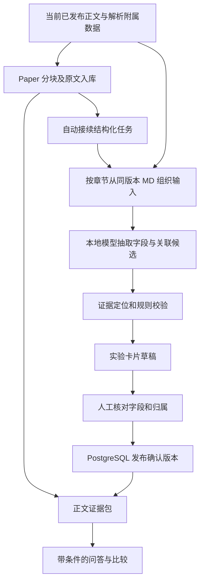

# 化学论文的实验结构化与字段级证据

状态：proposed
类型：architecture
Owner：backend/package/yuxi/services/knowledge_structure_service.py

## 问题

化学论文的制备条件、样品编号、测量条件和结果分散在正文与表格中。现有解析、校对和分块提供可读文本及来源，但检索命中某个结果块时，仍需要辨认它对应哪个样品、哪一步处理和哪组测量条件。把整篇论文压成一组温度、时间和结果会混淆实验；只在卡片末尾提供引用也无法核对各个字段。

本提案面向 Yuxi 维护者与化学领域审核者，目标是从当前论文正文生成可审核的实验记录，支持按条件比较，并使每个正式使用的字段与关联都可回查原文。用户已有技术路线作为需求背景，仓库源码拥有当前实现事实。

目标：保留原文；辨认样品与实验归属；提取制备步骤和测量结果；记录字段证据、缺失与歧义；完成抽取、人工确认、查询回读的最小闭环。非目标：重做解析和分块、替换向量库、部署新队列、训练模型、自动读取曲线坐标、构建完整化学本体或覆盖所有化学子领域。

假设：使用本地现成模型，不微调；第一批针对实验论文，以材料制备与表征问题为例。综述中的转述保留为转述，首期不自动生成可用于实验条件比较的卡片。补充材料首期作为独立文件处理，跨文件实验关联交由人工确认。

## 提案

### 本轮开发范围

本轮只交付“Paper 分块原文入库成功 → 自动创建实验结构化任务 → 从同版本 Markdown 全文分批提取并关联 → 保存带逐字出处的机器草稿 → 文件详情查看/失败重试”。不提供人工编辑、确认发布、正式问答消费、数值归一化、跨论文筛选和术语表。所有草稿保持 `machine_only`，不作为已审核科学事实。下文人工确认与问答等设计是后续阶段，不能作为本轮已实现能力。

初版三个实际持久化 Owner 是 `KnowledgeStructureRevision`、`KnowledgeStructureEvidence`、`KnowledgeExperimentCard`，由 knowledge schema 4→5 迁移创建。为缩小范围，本轮不新增文件确认指针或审核修订字段；当前草稿按最新 revision 与当前 Markdown 对象指针/正文指纹共同判定。Task 终态 hook 在同事务将完整结果标为 `draft` 或收敛失败/取消，任务记录清理后仍保留草稿结果或失败原因。初版失败不保留部分模型候选，超限明确失败；完整草稿的未归属事实保存在覆盖摘要中。

仅 `paper` 分块策略自动创建任务，其他策略不隐式增加模型调用。模型固定使用知识库显式配置的 `llm_model_spec`，未配置时卡片任务明确失败，原文索引保留成功。部署者需将该配置指向本地服务，不回落全局模型或另一供应商。原文与关联阶段均有限额，具体数值由[抽取模块](../../../../backend/package/yuxi/knowledge/structure.py)拥有，超限不截断成成功；模型请求只用已有适配器与严格 JSON/schema 校验，不新增 provider 兼容层。

初版对事实的要求是原文取值与逐字引文一致；归属引用必须同时出现样品标识并覆盖当前操作或测量字段。复杂文内别名、前驱体到产物的命名链、跨段共享方法无法可靠关联时保留未归属事实。输入全文扫描不证明模型抽取穷尽，零张卡片不证明论文没有实验。

本轮验收从分步交付中的单篇草稿闭环和来源查看开始。后续确认发布与问答验收仍为规划；本轮所有数据库、worker、模型与页面结果均未运行验证。本记录保持 proposed，等待部署电脑人工证据收敛。

### 实现方案

在现有知识文件旁增加独立的实验结构化结果，由 service 协调、本地模型提出候选、repository 保存版本和卡片，复用现有 Durable Task worker 执行。分块与向量索引继续处理原文；结构化结果作为有版本、有证据的派生数据单独审核和消费。

入库对已发布正文先执行 Paper 分块和原文索引，完成后自动接续实验结构化，无需点击生成卡片。手动入库可使用有待校对项的正文。页面分别展示原文索引和卡片生成进度；只有原文索引完成时不能显示整条处理链路已完成。结构化失败保留文件的 `indexed` 原文状态并明确显示卡片生成失败；普通正文问答继续可用。自动生成的是待核对卡片，卡片比较只消费当前正文版本下已人工确认的结果。



图表达完整提案，其中人工确认、确认版本与问答补充属于后续阶段。本轮代码装配到机器草稿和来源查看；`knowledge_structure` 的 Handler、成功 hook 和失败 hook 在 [Task registry](../../../../backend/package/yuxi/services/task_registry.py) 注册，结构化 service 拥有实际用例与事务边界。

### 现有能力与需要补齐的边界

| 层次 | 当前源码事实 | 本提案的使用方式 |
| --- | --- | --- |
| 正文和版面 | [解析产物发布](../../../../backend/package/yuxi/services/knowledge_parse_service.py)保存 Markdown、附属 JSON 与 attempt；[人工校对](../../../../backend/package/yuxi/services/knowledge_review_service.py)可在同一 attempt 内更新正文 | 冻结当前指针与正文指纹，不把“同一 attempt”视为正文未变 |
| 章节和检索块 | [Paper 分块器](../../../../backend/package/yuxi/knowledge/chunking/paper.py)产生章节路径、内容类型、证据标识和来源范围 | 复用结构线索，跨段实验归属由独立结构化用例拥有 |
| 来源定位 | [来源工具](../../../../backend/package/yuxi/knowledge/chunking/source.py)提供 Markdown 指纹和字符范围；PDF 页码仅来自可靠的唯一匹配 | 字段绑定更小的原文范围；没有可靠 PDF 页码时保留 Markdown 定位 |
| 持久化 | [知识模型](../../../../backend/package/yuxi/storage/postgres/models_knowledge.py)保存文件和 chunk；`extraction_result` 属于现有图谱抽取消费链路 | 新增实验结构化表，不占用图谱抽取字段 |
| 检索 | [Milvus executor](../../../../backend/package/yuxi/knowledge/implementations/milvus.py)已有向量、BM25、混合检索和来源回填入口 | 保留 Milvus；首期按正文命中文件读取相关卡片 |
| 后台执行 | [任务服务](../../../../backend/package/yuxi/services/task_service.py)与 registry 拥有持久任务、lease 和失败收敛 | 新增任务类型，复用 worker，不引入 Celery 或独立 structure-worker |

旧技术路线中的 Qdrant、独立队列服务是早期候选，不作为本提案依赖。结构化沿用当前 PostgreSQL、MinIO、Milvus、Redis/ARQ 拓扑。Paper 的职责遵循[只组织原文的决定](../implemented/2026-11-04-paper-chunking-boundary.md)。

### 实验卡片怎样表达化学事实

一张卡片对应同一论文版本中的一个明确样品及其制备变体，内部保存有顺序的制备步骤和多组测量记录。同一样品在不同温度、压力或方法下的结果分别记录。共同制备流程可由多张卡片引用相同证据，但“该流程适用于这些样品”的原文也必须保存。

| 对象 | 首期字段 | 约束 |
| --- | --- | --- |
| 论文上下文 | `file_id`、标题、DOI、语言、研究类型 | 首期用现有 `file_id` 作为文献入口；标题和 DOI 自动识别值仍需来源，不新增独立 paper 主数据系统 |
| 样品 | 原文编号、原文名称、文内明确别名、组别 | 身份局限于同一文件版本；不同论文中的 S1 不合并；名称近似不能证明为同一物质 |
| 制备步骤 | 顺序、操作、原料及用量、溶剂、温度、时间、压力、气氛、pH | 温度和时间归属于具体操作；干燥、煅烧、水热等步骤分开保存 |
| 测量 | 被测样品、指标、方法、测量条件、数值、单位、原文定性结果 | 制备条件与测量条件分开；一组测量对应一组明确条件 |
| 证据 | 原文片段、文档指纹、字符范围、可选页码和版面块 | 每个字段以及样品—步骤—结果的关联均可引用证据 |
| 人工确认 | 字段处理结果、关联处理结果、操作者、时间、修订号 | 模型候选、程序校验和人工确认分别表达 |

数值字段统一保留 `raw_text` 和可选标准值。原文 `500 °C` 可以提取为值 500、单位 °C；单位转换由明确的程序规则生成并保存转换来源。范围、约数、上下限、误差、百分数基准和干湿基等限定必须保留，不能把 `> 500`、`500 ± 5`、`400–500` 都压成 500。首期无法可靠解析的表达保留原文，禁用于数值过滤。

缺失值用 `null`，另记 `not_reported`、`ambiguous`、`unreadable` 或 `not_applicable`。`not_reported` 只表示本次已处理的正文范围没有找到，不宣称补充材料或未处理图片也没有。不得用 0、空字符串或常识补全。原文给出“室温”“过夜”“常压”时保留这些字面条件，不自动变为 25 °C、12 h 或 1 atm。

以下是虚构数据的字段级示意，省略其他字段。`evidence_refs` 引用同一结构化版本内的证据行；`review_status` 初始为 `draft`：

```json
{
  "sample_label": "S1",
  "preparation_steps": [
    {
      "operation": "calcination",
      "temperature": {
        "raw_text": "500 °C",
        "value": 500,
        "unit": "°C",
        "evidence_refs": ["ev_prepare_s1"],
        "review_status": "draft"
      },
      "duration": {
        "raw_text": "4 h",
        "value": 4,
        "unit": "h",
        "evidence_refs": ["ev_prepare_s1"],
        "review_status": "draft"
      },
      "sample_assignment_evidence_refs": ["ev_prepare_s1"]
    }
  ],
  "measurements": [
    {
      "property": "specific_surface_area",
      "method": {"raw_text": "BET", "evidence_refs": ["ev_method"]},
      "result": {
        "raw_text": "252 m² g⁻¹",
        "value": 252,
        "unit": "m²/g",
        "evidence_refs": ["ev_table2_header", "ev_table2_s1_row"]
      },
      "sample_assignment_evidence_refs": ["ev_table2_s1_row"],
      "test_temperature": {"value": null, "missing_reason": "not_reported"}
    }
  ]
}
```

实际 schema 对样品名、操作、指标、方法及定性结果同样使用带证据的字段结构；示例中的简写不豁免这些字段。跨段推导出的关联另存候选与理由，人工确认前不得作为确定归属参与比较。作者对机理的解释保留为“作者解释”；综述引用、基线值和文献对照值分别标识，不能算作本文样品的实测结果。

### 从原文抽取到卡片的流程

卡片的事实来源是已发布的当前 Markdown，分块提供章节、内容类型、来源范围及检索关联。处理顺序上先分块，再自动生成卡片；数据依据上始终回到同一版本的 Markdown。两者分别表达执行先后与事实来源。

模型无需一次接收整篇 Markdown。程序沿文档顺序，利用章节和已有来源把原文段落、完整表格与必要上下文组织成临时输入批次，先提取局部候选，再在论文范围关联。临时批次只服务本次抽取，不产生另一套持久化检索块。不将每个检索块视为一个独立实验，也不只抽取向量检索的前几个命中块。

1. **冻结输入。** 读取当前 `markdown_file`、`parse_assets_file`、attempt、正文 SHA256、当前人工校对修订号与 Paper chunk 来源。机器草稿使用已发布正文。后续正式结构化结果的发布仍要求完成正文校对并具备当前版本来源。没有待校对项也只证明当前校对流程完成，卡片仍逐字段审核。
2. **准备可引用片段。** 以原文范围去重，保留章节上下文、正文段、表格及图注，明确标记标题等上下文。模型读取原文片段，不把 chunk 中生成的“论文：”“章节：”前缀当作科学证据。输入窗口可按相邻来源组合；块长只限制推理输入，不定义实验身份。
3. **抽取局部候选。** 使用固定 schema 和少量人工编写示例，让本地模型输出原文字段、片段编号、逐字引文、样品候选与关联。按小节或完整表格批次处理；每个输入批次记录是否成功，不静默跳过超长表格。每个窗口的输出预算和调用次数有界，格式失败至多重试一次，仍失败记录该批次未完成。
4. **在论文范围关联。** 汇总样品、明确别名和原文交叉引用，再处理同一文件内的方法、表格与结果对应关系。输入只包含候选字段及其证据，避免再次把全文无边界塞给模型。仅同名、邻近或编号相似的关系保留待确认；原文明示的例外优先，例如“所有样品均处理 4 h，S2 除外”。
5. **程序核对与单位规范化。** 验证字段结构、引用归属、引文位置、数字及限定、单位与指标维度、重复候选以及样品关联证据。格式合法不代表科学事实成立；程序校验不能判定所有样品归属、方法等价或因果关系。
6. **生成草稿并人工确认。** 显示卡片及逐字段来源；审核者核对样品、步骤、方法、条件和数值，修改字段时同时选择依据。拒绝的候选留在审核结果中；缺失字段可保持缺失。首期全部卡片都需人工确认，不用模型自报的置信度自动发布。

第一次模型调用提出局部事实，第二次按论文关联；程序执行证据核对和确定性转换。无需为每个字段再启动一个 Agent，也无需为该固定流程引入新的 LangGraph 状态机。

本地部署可使用推理服务提供的 JSON Schema 约束输出，再在模型返回边界执行 Pydantic schema 与业务规则校验。vLLM 的[结构化输出](https://docs.vllm.ai/en/latest/features/structured_outputs/)提供格式约束；Pydantic 的[严格模式](https://docs.pydantic.dev/latest/concepts/strict_mode/)可以限制隐式类型转换。具体调用参数以部署版本为准，先核对当前 Yuxi 模型适配器与所选本地 endpoint 的协议；首期只接一种验证过的本地服务，协议不支持时明确失败，不自动改用云端。

首期结构化覆盖正文、已解析表格、图注中的明确文字。图片模型说明可供审核者参考，不能直接提供正式数值；曲线读数、图像内表格和仅在图片出现的结论保留未覆盖提示。参考文献列表不参与本文实验事实抽取。

### 字段级证据怎样稳定定位

当前 Paper 的 `chunk_id` 按块顺序生成，`evidence_ids` 是 `evidence_<原文起点>`。它们不提供跨文件、跨正文版本稳定的身份；`source_spans` 还含题名与章节范围，不能直接与 `evidence_ids` 按数组序号配对。

结构化证据由服务端独立分配 ID，身份包含知识库、文件、正文指纹和原文范围。模型只返回输入片段 ID 与逐字引文，由程序在该片段的原文范围内定位；重复引文必须唯一定位，否则要求人工选择。字符偏移由程序计算，采用现有来源工具的 Unicode 码点、零基左闭右开语义；前端转换为 JavaScript 字符索引时明确处理 UTF-16 差异。

当前机器草稿在输入批次内直接定位唯一的逐字引文，避免模型填错次序而丢弃可定位的证据。引文重复时使用从零开始的出现次序。没有逐字匹配或重复引文的次序越界时，任务报告具体失败原因。

每条证据保存 `source_sha256`、`start_char`、`end_char` 与 `quote`，满足 `markdown[start_char:end_char] == quote`。多个不连续来源使用多条证据，不用一个大范围夹入无关段落。页码、bbox、版面块 ID 只在可可靠映射时保存；没有它们不妨碍 Markdown 回查。

表格中的 252 只有与列标题、单位、样品行、相关脚注一起保存才构成可解释的结果。对合并单元格、多级表头或正文与表格冲突，保留原始表格及冲突候选，人工确认之前不进入正式数值比较。首期保留完整表格原文及相关范围，不把表格转成无上下文的散句。

### 最小持久化与发布边界

首期拟新增三张表，固定核心身份与版本列，实验字段使用受 schema 约束的 JSONB。暂不把每种化学指标拆成独立表，也不引入可配置字段平台。

| 拟新增表 | 主要内容 | 消费者 |
| --- | --- | --- |
| `knowledge_structure_revisions` | `revision_id`、知识库与文件、attempt、正文指纹和不可变正文指针、校对修订号、schema/prompt/模型版本、Task ID、输入覆盖与失败批次摘要、审核修订号、确认人和时间 | 任务、审核、当前版本判定 |
| `knowledge_structure_evidence` | revision、证据 ID、逐字引文、字符范围、可选页码和版面信息 | 字段审核、来源查看、答案证据 |
| `knowledge_experiment_cards` | revision、卡片 ID、论文内样品身份、制备步骤、测量记录、字段及关联证据、审核结果 | 卡片页面、相关实验读取、后续条件过滤 |

文件记录拟增加 `current_structure_revision_id`，只指向已确认版本。新任务先产生草稿；草稿编辑检查审核修订号，避免并发覆盖。确认后版本不可变，修改已确认结果时创建新草稿；模型重新抽取也产生新 revision，首期不自动把旧人工修改合并进新候选。

证据和卡片通过 revision 外键归属文件和知识库，删除按归属清理；文件的当前指针与 revision 必须属于同一文件。JSONB 内的证据引用由 owning service/repository 在写入与发布时检查同 revision 归属。结构化证据不以 `KnowledgeChunk` 外键保存，避免重新分块删除 chunk 时误删仍对应同一原文的实验依据。chunk 与卡片的检索关联按文件、正文指纹和原文范围计算，不持久化必须随每次重分块维护的另一套映射。

原文入库成功时，在发布文件 `indexed` 状态的同一 PostgreSQL 事务内保存结构化 Task、冻结输入版本和草稿意图，提交后投递 ARQ；投递失败由已有 pending publisher 补发。该接续点覆盖自动入库和单独入库路径，避免只在某个页面或批量入口接线。执行使用 Durable Task 自身的 owner/lease，不占用文件的 `parsing/indexing` 状态；重复活跃请求按文件与输入版本去重，同版本已有可用结果时不重复生成。模型调用在长事务和文件锁外执行；每批候选持久化前验证 lease，迟到 worker 不得写入当前草稿。

最终人工确认在现有文件操作锁内开启短事务，核对文件归属、当前 attempt、正文指纹、校对修订号、草稿修订号和全部证据引用，再原子写入确认结果与文件当前指针。正式发布要求所有输入批次处理完成，保留每张卡片及其关键关联的人工处置，至少有一张确认卡片；没有实验的论文可以保存已审核的“未发现实验”结果，但不能伪造空卡片。

批次失败或取消的草稿可查看，明确显示未完成范围，不能发布为完整结构化结果。错误、取消和 worker 失联的执行结局由现有 Task 保存，不另造一套运行状态机。重试创建新 Task 与草稿；首期从冻结输入重新抽取，不实现复杂的部分续跑。

正文重解析、人工正文修订和文件删除必须接入结构化失效或清理；正式读取同时检查当前指针、attempt 和正文指纹，防止遗漏失效通知后返回旧卡片。历史已确认版本可保留审计，界面标为旧正文依据，禁止作为当前事实。仅调整分块长度而正文、校对语义版本均未改变时，卡片证据仍有效，重新计算检索关联即可。仅后台图片说明更新不使未依赖图片说明的正文卡片失效。

Schema 变更只通过现有 `storage-migrator` 升级 knowledge 域版本。旧文件的当前结构化指针为空，不做隐式全库抽取。结构化数据不写入 `processing_params`、Redis 或图谱 `extraction_result`。MinIO 继续保存不可变原文和附属产物；首期不再生成另一份可独立编辑的结构化 JSON 文件。

### 后端与页面接入

后端拟新增 `knowledge_structure_service.py` 拥有抽取、审核和发布用例，`knowledge_structure_repository.py` 拥有版本、卡片和证据查询；领域内 schema 与抽取规则放在 `yuxi.knowledge` 的结构化模块。HTTP 路由保持薄，模型调用复用 [chat 模型入口](../../../../backend/package/yuxi/models/chat.py)，任务复用 registry。实验语义不放入 parser、Paper 分块器或图谱 extractor。

正常结构化任务由入库成功事务自动创建。接口围绕现有 `/api/knowledge/databases/{kb_id}/documents/{doc_id}` 文档路径提供读取草稿与当前版本、修改草稿、确认版本和失败重试动作；失败重试复用相同提交用例，并校验预期输入版本。编辑与确认携带审核修订号，版本变化返回冲突并要求重读。页面不提供正常流程中的“生成实验卡片”必经按钮。接口名字在实施时随路由契约确定，本文不将拟议动作写成已存在 API。

写操作要求现有 manage 权限；读取要求 read 权限。service/repository 查询同时限定可见知识库、文件和 revision，不能只凭 card ID 或 evidence ID 查询。worker 执行和最终发布前重新校验任务发起者是否仍有管理权限；Agent 读取结果继续遵循当前用户与 Agent 选中知识库的交集。下载、证据查看和后续检索均使用同一授权边界。

前端在现有文档工作区增加“实验结构化”页签，布局为样品/卡片列表、字段详情和原文来源区域。每个字段可点开原文；表格结果同时显示表头、行和脚注。支持确认、修改并选依据、拒绝候选、标记无法确定；把“正文待核对”“抽取未完成”“待确认”“当前已确认”“正文已变化”显示清楚。解析校对与实验结构化审核分别记录，改实验字段不改论文原文。

首期不建设独立审核系统；前端 API 放在现有 `web/src/apis`。领域术语先保存文内别名及经人工确认的少量中英文名称，不自动将不同晶相、化学式或缩写合并；跨论文术语表等出现实际查询需要后再独立设计。

### 问答怎样消费结构化结果

首期沿现有原文检索命中的文件与来源范围，补充相关的当前已确认卡片，再组成证据包。命中结果表时补充对应样品的制备与测量依据，保留不同论文的分组。只有文件相同仍不足以认定相关，必须核对样品、指标、条件或来源范围，避免整篇所有实验卡片灌入上下文。

卡片用于组织事实和比较条件，答案仍引用原文字段证据。普通正文路径可回答没有卡片的论文问题，并明确未使用结构化条件比较；要求精确条件筛选时，只覆盖已确认且字段可解析的数据，并返回覆盖范围。不能把“没有卡片匹配”写成“整个知识库没有这种实验”。缺失结果、冲突条件和作者推测在证据包中保留相应限制。

后续确有“煅烧温度在某范围且孔容达到某值”的需求时，再增加有限的结构化过滤参数：白名单指标、单位、范围和条件层次由服务端定义，模型只填受约束的查询对象，不生成任意 SQL。同一卡片的不同测量不能分别满足两个条件后被拼成同一组实验；比较时核对测量方法、样品基准及条件是否相容。

首期不为卡片新增向量集合，结构化只做正文召回后的补充；因此不能保证单靠数值条件就召回全库卡片。确认字段与查询需求稳定后再实现 PostgreSQL 条件检索，必要时才评估派生卡片索引。Neo4j 的后续投影不能替代 PostgreSQL 的实验事实与审核记录。

### 分步交付与人工验证

| 阶段 | 交付结果 | 在部署电脑的验证方式 |
| --- | --- | --- |
| 1. 定义首批字段与人工参考 | 选择 3–5 篇实验论文，人工标注样品、步骤、测量、数值及原文范围；包含多样品、多步骤和表格 | 第二位审核者核对完整记录，确认哪些问题能靠这些字段回答；未覆盖的图像结果单列 |
| 2. 单篇草稿闭环 | 新 schema、repository、Durable Task 与固定本地抽取；入库分块后自动生成有证据的草稿 | 通过真实 HTTP 执行入库，不调用额外生成动作，回读结构化 Task、PostgreSQL 卡片、MinIO 对应正文及失败批次，核对字段与关联 |
| 3. 人工确认与来源页面 | 卡片查看、修改、证据定位和确认发布 | 实际页面操作并回读确认版本；核对 Unicode、重复引文、表格来源、旧版本和并发修改 |
| 4. 接入正文问答 | 检索后按样品和来源补充已确认卡片 | 使用固定事实题与比较题，逐项核对最终证据包、条件分组和回答引用；加入无卡片及证据不足问题 |
| 5. 扩大样本并增加筛选 | 扩展到覆盖主要版式和业务问题的代表论文，再决定结构化过滤与批量抽取范围 | 人工统计字段、关系与未覆盖比例；固定独立验收题后检查跨论文比较和数值筛选，不以演示成功推断规模质量 |

第一轮的直接产物是一篇可逐字段回查并人工确认的实验记录。没有可靠的样品归属之前，暂缓跨论文条件排序；没有足够的卡片覆盖之前，暂缓宣称全库精确筛选。

## 替代方案

- 直接对全文生成一个 JSON：接入简单，适合探索字段；长文遗漏、跨样品混合与位置校验难以观察，不作为正式抽取链路。
- 等正文全部校对后才生成草稿：会让手动入库的论文无法立即查看提取结果。草稿使用已发布正文，正式发布再裁决证据质量。
- 每个检索块独立生成一张实验卡：容易复用分块循环，但一次实验经常跨方法段、结果段和表格，一块也可能包含多个样品；保留局部候选，增加论文范围的关联和审核。
- 在 Paper 分块时追加制备和测量条件：能让块携带更多上下文，但职责及原文边界已由现有决定收敛；独立卡片更适合显式保存关联、歧义和审核。
- 直接复用图谱三元组与 `extraction_result`：可以复用模型调用经验，但图谱实体与关系不直接表达有序制备、多组测量和字段审核；实验事实单独存储，图谱投影后置。
- 只保存一个文件级 JSON：原型成本最低，但卡片审核、证据约束、版本发布和文件删除会落到无结构约束的文档操作；选择三张小表与固定 schema，不扩展为通用抽取平台。
- 立即更换向量库、引入专业化学抽取依赖或更大模型：现有差距主要在事实归属、字段证据与审核消费链路；首期复用 Yuxi 拓扑，先获得本地人工参考与错误分布。

## 验收标准

### 本轮部署电脑人工验收

1. 先由部署流程运行 `storage-migrator`，回读 `knowledge` schema 版本为 5，三个实验结构化表存在；已有文件与 chunk 内容不变。API/worker 只校验版本，不执行 DDL。
2. 在知识库设置显式选择本地聊天模型，选择一篇已完成校对的多样品论文，用 Paper 策略入库。无需调用额外生成接口；回读文件为 `indexed`，并存在同文档的结构化 Task/revision。页面分别显示原文已入库与卡片等待/进行中。
3. 在文件详情打开“实验卡片”，等待独立任务结束。逐字段点开出处，核对 MD 的原句、样品编号、温度、时间、表头、单位及样品行；核对卡片字段与 PostgreSQL 保存内容相同。不同样品、制备步骤和测量条件不得混成一条记录。机器草稿标识始终可见。
4. 修改或伪造模型引文、输入错误的事实 ID、用 S10 的归属引文关联 S1，预期任务明确失败；输入超长表格或超出全文容量，预期失败且不显示完整草稿。没有形成卡片时，页面不能宣称“论文没有实验”；完整任务的未归属信息可查看出处。
5. 清空知识库聊天模型后入库，预期原文仍 `indexed`、卡片明确失败。配置有效本地模型后，用 manage 身份重试，产生新 Task/revision；read 身份直接调用重试接口应拒绝且不新建任务。跨知识库传文件 ID 同样拒绝。
6. 在卡片任务中断开投递、取消任务或停止 worker，回读 Task 与 revision；投递意图应能补发，取消/失联不得一直显示正在生成，失去 lease 的旧 worker 不得保存卡片。重新入库同一正文、同一模型时，已有进行中或完整草稿应复用。
7. 卡片生成后修改正文并保存校对，预期旧卡片显示正文已变化；重新 Paper 入库才自动生成当前正文草稿。切换文件或关闭详情时，迟到请求和轮询不能显示到另一个文档；检查窄屏、明暗主题、加载、空态和错误状态。
8. 用正文状态为 `needs_review` 或 `incomplete` 的已解析论文手动 Paper 入库，回读 `indexed` 文件与同版机器草稿。已有同版失败任务可直接重试。用同样的校对状态走上传后自动入库，预期本次自动索引仍被跳过。
9. 对照模型输出和当前 Markdown 批次，核对唯一逐字引文在模型误填次序 `1` 时指向实际位置。相同引文在同批出现两次时，次序 `1` 应指向第二处，次序 `2` 应报告越界。改动引文中的数字或标点，使原文没有逐字匹配时，任务应报告引文未匹配。

以上预期尚未在本机执行。语义 Reviewer 应核对预期独立于实现，部署后将真实 Task、PG、MD 与页面结果分别记录；源码审查和空白检查不替代这些证据。

以下矩阵覆盖完整提案，后续人工发布与问答消费不属于本轮初版。已有初版源码尚无运行通过结论。实施 PR 由独立 Reviewer 对照完整需求、实际 diff 和真实结果审查；字段归属由化学审核者核对，工程 Reviewer 不以 JSON 合法代替科学正确性。

| 验收主张 | 失败面 | 语义 Owner | 直接证据 / 命令 | 负向案例 | 当前结果 |
| --- | --- | --- | --- | --- | --- |
| 入库分块后自动生成卡片，且来源是同版本 Markdown | 漏接某个入库入口、需要额外点击、只抽取部分命中块或串用旧正文 | 原文入库成功事务、Task registry 与结构化输入准备 | 分别通过自动入库和单独入库操作，回读 Task、输入指纹、卡片与阶段状态 | 入库提交后中断投递应补发；改变分块长度仍应覆盖方法与结果；卡片失败时不能显示全链路成功 | Not run：尚未实施 |
| 正式卡片的每个非空字段与关键关联可回查当前原文 | 引用存在但内容错误、跨版本或跨文件 | 拟新增结构化 service/repository 与证据表 | 真实 HTTP 提交并确认，回读字段引用及原文字串，逐条核对范围 | 使用重复引文、伪造证据 ID、其他文件的 S1 或失效 hash；拒绝发布并显示原因 | Not run：尚未实施 |
| 样品、步骤和测量不会被错误合并 | 同名样品、例外条件或相邻结果被自动拼接 | 实验 schema、关联规则与人工确认 | 对多样品论文逐项核对卡片和原文；确认异常候选的处理结果 | S1 与 S2 不同温度；同一 S1 的两个测试温度；共用流程中 S2 例外；保留分组与歧义 | Not run：尚未实施 |
| 缺失与未覆盖内容可观察 | 将缺字段填为常识，或把未处理视为未报告 | 模型返回校验、覆盖摘要与卡片消费者 | 回读缺失原因、未完成批次、图片范围和查询覆盖说明 | 原文“过夜”、压力缺失、仅图片存在的数值或超长表格；不得补值或宣称全覆盖 | Not run：尚未实施 |
| 数字及表格单位正确且可解释 | 只核对数值出现，丢失行列与限定 | 证据构建、确定性转换和人工审核 | 回读表头、样品行、脚注、原文值和标准值 | 比较 m²/g 与 m²/kg、范围与单值、脚注修正及相邻行；无法确定时禁用正式比较 | Not run：尚未实施 |
| 正文变化后旧卡片不能成为当前事实 | 同 attempt 修订或失效通知遗漏 | 正文发布与结构化 repository 读取边界 | 修改正文后回读当前指针和结构化接口，再运行问答 | 保持 attempt 不变但改一个数字；旧卡片仅作历史显示，当前问答不消费 | Not run：尚未实施 |
| 重复执行、取消和失联不会发布半成品 | 失权 worker 迟到写入、部分批次失败被当成功 | Durable Task、草稿写入与确认事务 | 真实 worker 中断/取消，回读 Task、草稿、旧确认版本和当前指针 | 批次中断、重复投递、两个审核者同时确认；旧 owner 与旧修订写入被拒绝 | Not run：尚未实施 |
| 无权限或串用 ID 无法读写结构化数据 | 只在页面检查，直接接口与任务仍可绕过 | 权限依赖、结构化用例与可见性查询 | 不同权限身份操作真实 HTTP，回读数据库是否改变 | 无 manage 的写入、跨知识库证据 ID、任务运行中撤权；拒绝副作用 | Not run：尚未实施 |
| 卡片确实改善条件组织且保留证据限制 | 只生成卡片但问答未消费，或跨条件拼接结果 | 检索后证据装配与 Agent 知识工具 | 固定问题回读实际证据包和最终答案，人工核对条件、引文与覆盖范围 | 两论文 S1 同名、缺测量条件、正文有证据但无卡片、零卡片命中；不得误合并或把零命中写成全库不存在 | Not run：尚未实施 |

抽取质量分开统计：字段精确率是候选中正确的字段比例，字段召回率是人工参考字段中被正确提取的比例；样品/步骤/结果的关联正确率另算；数值、单位、限定与表格归属逐项核对。证据可定位率、缺失误填数、冲突未提示数与输入覆盖比例单列。人工确认后的数据质量与确认前模型质量分别报告，不能只统计被模型成功提取的部分，也不预先承诺 95%。

本提案的当前证据是 `Inspected`：只读核对架构、模型、来源工具、Paper、校对、索引、任务 registry 及模型调用入口。模型效果、数据库迁移、HTTP、worker、并发、页面和答案质量均为 `Not run`。按本机工作约定，不启动程序，不运行测试、构建或工程验证脚本；这些结果须由用户在部署电脑完成操作后补充。

## 风险

首要风险是输入正文错误和科学归属错误。引文能定位只证明引用位置正确，不能证明该测量属于某个样品；程序不能消除这类语义风险，首期采用逐卡片和字段人工确认。结构化流程不得自动修改解析原文来“消除”不一致。

全量人工确认增加首批整理成本；优先覆盖实际问题需要的字段，记录每篇耗时和修改分布，再决定是否缩小 schema 或增加有明确负向案例的自动处理规则。模型、schema 与 prompt 的组合版本必须可追溯，本地模型服务不可用或输出协议不支持时明确失败。

JSONB 方便首期迭代，但复杂过滤和大规模统计需要以实际查询为依据增加索引或规范化测量记录；在查询需求出现之前不预建全套化学数据仓库。跨论文术语规范化、补充材料关联、图片数值和复杂多级表头仍是未覆盖范围。

历史正文、已确认版本与引用需要一起定义保留策略，显式删除文件时清理其结构化数据。原文更新、图谱构建和重入库现有锁边界必须在实现中核对，真实 lease、并发和跨存储结果依赖部署环境人工回读，静态设计不能证明它们已经成立。
