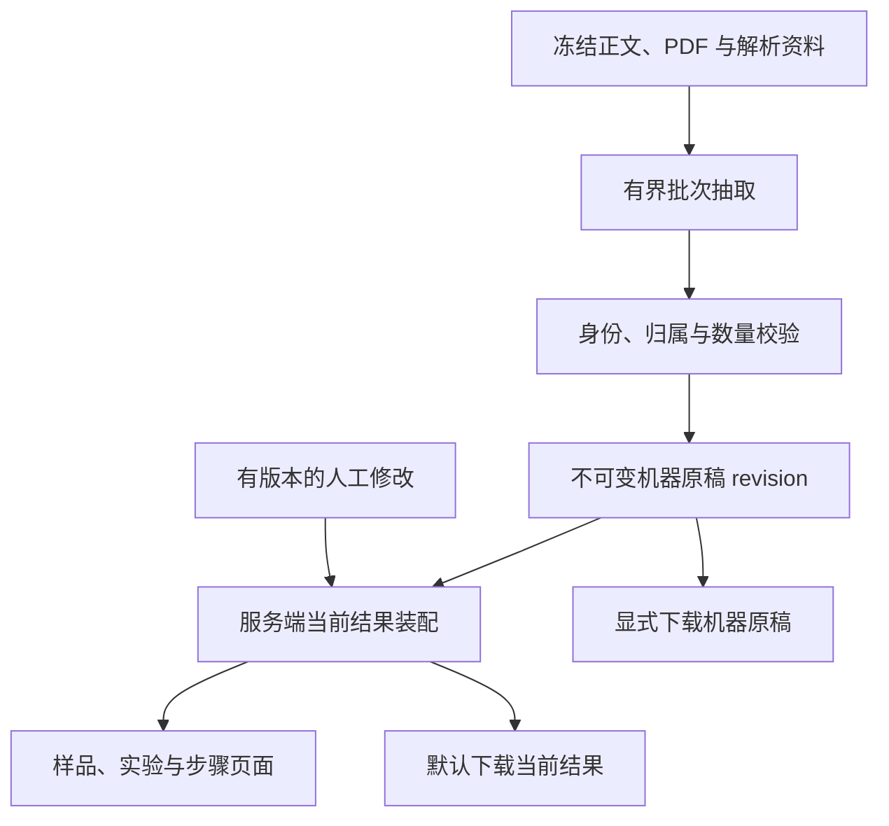

# 实验结构化的身份、校验、恢复与校对结果导出

状态：proposed
类型：architecture
Owner：backend/package/yuxi/services/knowledge_structure_service.py

## 问题

本文面向实现实验结构化的开发者、工程 Reviewer 与部署端验收者，提出八项缺口的解决方案：同名样品状态混合、观测关联错误实验、数值单位及限定词校验不足、制备步骤串用、部分完成无法重新提取、长文单次输入过大、已报告信息缺少合法字段、人工修改未进入下载结果。问题来自源码静态审查，实际触发结果仍需部署端验证。

目标是让样品、实验、步骤及结果保持明确身份，让可采用的机器数据通过归属与数量校验，让部分失败可以重做，并让默认下载与页面采用同一份当前数据。验收同时覆盖机器原稿、人工修改、页面、下载文件和 PostgreSQL 最终记录。

本阶段不接入正式问答、跨论文比较或全库筛选，不重新实现解析与分块，不读取曲线坐标，不新增队列、通用字段配置平台或自动化测试套件。

假设沿用显式配置的知识库模型、现有 Durable Task、PostgreSQL、MinIO 和共享模型准入。已有记录直接保存为 edited 的交互继续保留；人工修正可以与机器引文字面不同，其来源与操作者必须可追溯，不能因此标为机器验证通过。

本提案在评审和实施后部分取代[规范 JSON 输出](2026-11-09-canonical-adsorption-output.md)、[直接修改](2026-11-10-experiment-direct-edit.md)及[规范实验工作台](2026-11-10-canonical-experiment-workspace.md)中的身份投影、机器原稿下载与版本选择方案，补充[跨论文字段](2026-11-10-experiment-registry-and-paper-neutral-fields.md)和[人工校对队列](2026-11-10-experiment-correction-queue.md)。源码继续拥有当前实现事实，本文不表示八项改动已经实现。

## 提案

### 实现方案

[结构化用例](../../../../backend/package/yuxi/services/knowledge_structure_service.py)统一装配机器原稿、人工修改和当前结果；[仓储](../../../../backend/package/yuxi/repositories/knowledge_structure_repository.py)拥有权限、版本、结果归属和事务内持久化；[抽取编排](../../../../backend/package/yuxi/knowledge/structure.py)拥有有界批次与覆盖结果；[契约](../../../../backend/package/yuxi/knowledge/adsorption_contract.py)及[数量核对](../../../../backend/package/yuxi/knowledge/adsorption_review.py)分别拥有记录关系和原文数量校验。前端只消费服务端已装配的归属与当前值。

一次处理结果以 revision 归属机器原稿、证据、卡片和人工修改。人工修改以明确目标的覆盖记录保存，服务端在读取时生成当前结果；页面、搜索、实验详情、制备步骤和默认下载复用该结果，不另存一份可以独立编辑的合并 JSON。

重新入库采用清理后重建语义：清理该文件的旧分块、向量及相关图谱，并删除全部旧实验 revision、卡片、结构化 JSON、证据、人工修改和校对回执，再生成新结果。原 PDF 与已发布解析正文继续作为输入。重新提取采用相同的结构化清理规则，但保留已有正文索引。新任务成功后直接发布；本轮不增加历史实验版本、草稿采用或人工修改跨次迁移机制。

### 样品、实验和结果的身份

同一 revision 内，样品批次、样品状态、实验、制备操作和观测继续使用各自独立 ID；观测内可独立编辑的结果增加 result_id。ID 在候选接收时由服务端固定，改名、改值、排序和修改条件不改变 ID。不同 revision 的 ID 不承诺相同，不能据此自动迁移人工修改。

卡片和单样品人工记录保存 sample_state_id；测量同时保存 observation_id、result_id 和对应 run_id 或契约规定的 run_ids。名称、指标标签和列表下标均不作为身份。服务端投影按 ID 分组，页面选择、筛选和出处定位使用同一 ID。同名样品用原文状态、批次区分，仍同名时附短编号；不根据名称相同自动合并。

多样品定性观测和排序属于显式组记录，保存完整 sample_state_ids 集合及组记录 ID，不能伪装成多个互不相关的单样品事实。页面在各样品处显示同一条组观察，编辑时明确展示「修改这条组观察，适用于 S1、S2」及完整对象集合；保存只更新这一组记录，不能因入口来自 S1 就隐式更改其他样品的独立测量。组记录不提供隐式单样品改值；确有独立结果时另行补录单样品测量，并由审核者决定保留或排除原组观察。服务端验证提交的对象集合与目标组一致。

分批抽取的局部编号先带批次作用域，再映射到论文内正式 ID。同一样品的重复提及只有在原文定义、明确别名或前后状态链能够唯一对应时才合并；只有同名或相邻位置时保留候选关系，交给人工选择。人工选择既有样品提交 ID；需要新增样品时，通过固定样品表单创建批次与状态，不把自由输入的名称隐式当作既有样品。

所有观测变体在有效记录发布前执行以下关系校验，规则放在契约 Owner，覆盖模型输出、人工保存和导出装配三个边界：

| 关系 | 接受条件 | 无法确定时 |
|---|---|---|
| 观测与实验类型 | 观测类型与直接测量、拟合、预测、推导或计算实验匹配 | 保留候选与原因，不装入有效机器记录 |
| 观测与样品 | 观测样品属于该实验明确声明的样品集合 | 拒绝跨样品关联；实验未声明样品时要求补齐关联 |
| 推导观测与样品 | 通过该推导实验明确引用的上游实验得到唯一合法范围 | 缺少上游引用时待人工处理，不借用同名实验 |
| 观测与物种 | 单一气体或有序物种对属于实验明确声明的物种，且顺序保留 | 不交换分子分母，不从其他实验补气体 |
| 观测与条件 | 温度、压力、组成和基准与所关联实验相容；多条件实验的单条观测明确指出适用条件 | 条件未报告则保留缺失；冲突则交由人工处理 |

样品结果按实验 ID 组织方法与条件，相同方法的两个实验分别显示。已有多个实验的观测保存完整实验集合。修改测量的样品归属时，选择能够接受该样品的实验。机器漏登实验时，在实验目录补录原文报告的方法、样品、物种、条件和出处。原文确实没有报告实验关联时，使用后文定义的 reported_measurement 声明缺失原因。

### 数值、单位与原文依据

统一数量契约覆盖现有全部数值观测及其条件。数量保留完整 raw_text、原始单位、可确定的规范单位和取值基准；标量、范围、带误差值及文字条件使用明确变体。operator 只接受等于、大于、大于等于、小于、小于等于和近似；范围保留端点与开闭信息，误差保留中心值及误差。不能解析的表达保存原文文字，结构化数值留空，不截出一个数字代替整体含义。

机器数量的接受需要同时满足：

1. 程序能在本次冻结正文中定位完整数量表达；数字、正负号、指数、比较限定、范围端点、误差与单位共同核对。重复文本使用明确的范围，不从全文任意命中借证据。
2. 表格以样品行、指标列、对应表头单位和相关脚注共同确定值；多级表头、合并单元格或脚注无法唯一解释时转人工候选。正文的多个样品或物种并列报数必须有明确对应关系，单纯同段出现不够。
3. 原始单位与原文一致，规范单位与该指标的量纲及比例一致。首期只规范同一比例的写法，如 m² g⁻¹ 与 m²/g；mmol/g 与 mol/g 保持不同，不隐式进行千倍换算。未支持的单位保留原文，规范单位为空并标记待核对。
4. 温度、压力、数值范围和误差满足内部约束，不能出现最小值大于最大值或误差为负。原文「室温」「过夜」保留文字，不能填成 25 °C 或 12 h。

每个被拒数量保留候选值、完整原文范围和具体原因。有效 JSON 不保留已判定错误的数量，其他独立结果继续保留。部分输入无法定位时，覆盖摘要指出实际缺口，不把「已处理完批次」表达成「已经抽全实验事实」。

人工修改继续直接保存，不增加核对勾选或重复确认。表单提交结构化数量与原文显示值，服务端核对字段类型、内部一致性及当前版本出处身份；人工修正与原文字面不一致时记录 manual 来源，不伪装为机器核验成功。无法形成规范数值的人工文字结果仍可保存和导出，数值和规范单位保持空值。数值输入若与其显示文字自相矛盾，保存明确报错。

### 制备步骤的归属与修改

有效操作明确保存 applies_to_sample_state_ids。归属来自原文明示的适用样品，或沿明确的中间体输入、输出关系追溯到最终样品；仅仅处于同一条路线不能证明适用于全部样品。无法确定适用范围的步骤保留为候选，不自动复制到各个样品。

制备页面直接读取服务端按样品 ID 筛出的操作及其顺序，不自行遍历整条路线补齐步骤。人工记录的目标使用 operation_id 与 sample_state_id，同名的两次干燥、洗涤或热处理分别对应各自操作，前端取消按操作名称和卡片下标反查身份。

对共享操作的人工编辑默认只作用于当前样品。服务端为该样品建立操作覆盖；装配当前 JSON 时从原操作适用集合移出该样品，并生成有独立操作 ID、保留原操作关联的修订步骤，其余样品继续读取原操作。更换样品归属、改为测量或排除同样只作用于目标记录。修改整个共享流程不在本轮编辑入口内。

共享中间步骤沿目标样品的既有输入输出链分支。修订操作及其下游共享操作获得独立的操作、试剂使用和中间体 ID。目标样品使用修订后的分支，其他样品和未受影响的上游使用原编号。派生编号由原编号和样品编号确定，当前 JSON 的 extraction_metadata 保存派生编号与原编号的对应关系。遇到无法确认的跨路线中间体依赖时，保存会要求先核对归属。

当前结果中每个样品只出现一次相应操作。条件、试剂和顺序均读取同一份修订步骤，不能出现列表采用人工值、详情继续采用机器值的混合。需要改归其他样品时验证目标样品及其路线归属，无法匹配时显式补录路线；不自动把无关样品塞进既有路线。

### 分批抽取与长文容量

抽取仍在现有 Durable Task 内执行，复用共享模型准入、取消与 lease。先沿冻结 Markdown 的章节及原文范围建立批次，再分别提取局部登记、实验和观测，最后处理有明确引用的跨批关联。每个阶段只携带当前批次与相关编号目录，取消每次发送全篇原文的调用方式。

模型实际上下文容量由现有供应商模型元数据传到运行时 ModelInfo，允许在该模型已有配置中补充缺失容量，不新增知识库专用容量设置。若容量未知，准备阶段明确失败并提示补充模型信息；不能假定某个固定窗口适用于所有本地模型。

输入预算按「模型上下文容量 − 完整系统提示与 Schema − 当前目录 − 输出预留 − 安全余量」计算；另受模型独立输入和输出上限约束。优先使用适配器可用的匹配 tokenizer，缺少时使用 UTF-8 字节数作保守估算并保留余量，覆盖完整消息和包装开销。估算和真实供应商拒绝分别记录，不宣称估算等于实际 token。

普通长段按句界拆分；表格按数据行拆分，每批带同一表头、单位和必要脚注，并分别引用原始表头、数据行及脚注范围。公式、代码和不可分单元保留整体。单个不可分单元加上必要上下文仍超过预算时，记录该范围未完成并说明原因，不能截取前缀后标为完成。现有全文大小上限仍是资源边界，超限在创建有效结果前明确说明。

长目录按当前证据明确提及的样品、实验及其上游引用分组；不能为了缩短输入任取前若干 ID。跨批关系缺少唯一依据时保留待校对候选。登记去重与依赖解析也分组执行，不再增加一次携带全文或全目录的无界关联请求。

批次摘要保存 source_sha256、原文范围、上下文范围、状态、失败原因和有效条目数，随当前 Task 的 owning transaction 写入 revision；不新建批次工作流或子任务系统。覆盖率按原文范围并集计算，重复表头和上下文不重复计入。参考文献等明确排除范围单列；无可靠 PDF 页码但有同版 Markdown 坐标的片段仍可处理，页码保持 null，不默默从输入删除。

模型执行结果保留适配器提供的结束原因，明确截断的响应不能当作完整输出。响应截断或记录容量不足时最多进行两级二分重做，保留父子范围关系；最小单元或分拆上限仍失败则记录未完成。普通格式错误沿用一次重试。执行期间只发布进度与覆盖摘要，有效机器结果在最终校验后发布。部分失败保留独立有效记录及可恢复候选，未处理范围保持可见；无有效记录且无可恢复候选时明确失败。

### 重新入库与重新提取

manage 用户发起重新入库时，旧实验数据与旧检索数据一起清理后重建，正文、模型和提示版本相同也不复用旧实验草稿。清理范围是该文件全部实验 revision 及其卡片、规范 JSON、证据、批次摘要、人工修改和校对回执；旧部分结果同样删除。原 PDF、已发布 Markdown 和解析附属资料保留，作为本次重建输入。操作入口明确说明人工修改将被清除，不新增历史版本保留或迁移步骤。

清理发生在请求权限、文件归属及输入前置条件通过后，由实际入库 Task 在取得执行权时执行。文件进入 indexing 与旧实验数据删除在同一 PostgreSQL 事务提交。随后清理原分块、向量及其相关图谱，再重建分块和向量。图谱由现有图谱构建入口单独生成。任一后续阶段失败时记录该阶段的错误，已清理的旧实验数据不恢复。权限、输入和执行权是清理的前置条件。

只需重做实验结果时，使用「重新提取」：复用已有正文索引，删除相同范围的旧实验数据后，从整篇冻结正文重新生成。新结构化 Task、revision 与结构化清理在同一事务内创建，提交后投递。重新入库仍在原文 indexed 成功事务中自动创建全新的结构化 Task/revision，再提交后投递。两个入口均执行整篇抽取，不做失败批续跑。

清理时记录旧结构化 Task ID，事务提交后在文件锁外请求取消旧 Task；取消通知仅用于节省执行资源。旧 revision 被删除后，旧 worker 即使迟到返回，也必须因原 revision 不存在或不再是当前执行版本而拒绝保存和发布，不能重建被删 revision。旧 Task 的最小状态记录仍供任务系统收敛，不保存可供历史下载的实验内容。

复用现有 revision 状态 pending、draft、failed、cancelled。新 Task 成功 hook 原子发布本次 draft，无需人工「采用新草稿」。清理后生成期间页面展示正在重建、禁用实验编辑与下载；若重新入库失败，实验结果保持空并展示入库失败；若原文 indexed 而结构化失败，原文仍可检索，实验区域展示失败并允许再次重新提取。部分完成草稿展示本次有效数据、覆盖缺口及校对任务，可以再次清理重做。

请求绑定用户看到的 revision、正文指纹及当前处理任务。同文件已有等待或执行中的重建任务时返回该 Task 或明确冲突；重复点击不再次清理，不新建并行任务。清理与并发人工保存共用文件锁：先保存的修改随清理删除，清理后的旧 revision 保存明确返回 409。旧页面下载和迟到响应同样按 revision 拒绝或废弃，不再显示被清理的数据。

任务区域表达入库、结构化生成进度及仍有未提取内容。校对待办数量只统计本次人工任务，不能代替抽取覆盖状态。技术报错仍留在本次机器 JSON，日常校对页不恢复技术诊断列表或常驻大幅提示栏。

### 可填写字段与契约演进

在[JSON Schema](../../../../backend/package/yuxi/knowledge/adsorption_schema.json)内逐项审查仅允许 null 的字段，按化学语义区分「原文未报告」与「系统无法承载」。首批明确支持以下已有字段，不为每篇论文复制 Schema：

| 字段 | 可报告内容 | 未报告时 |
|---|---|---|
| 样品 physical_form | 粉末、薄膜、纤维等原文字面形态 | null，并保留缺失原因 |
| 批次 batch_number | 原文批号或编号字符串，保留前导零 | null，不按出现顺序造批号 |
| 路线 yield | 带原文、单位及基准的数量或文字表达 | null，不以 0 代替 |
| 路线 replicate_count | 原文重复次数表达和可确定的正整数 | null，不默认做过一次 |

其他确可报告的现有 null-only 字段采用同样的显式类型修正。既有 reported_parameters 只承载所属操作或实验的原文参数名、raw_text、value 和 unit；仍拒绝任意嵌套对象、错误类型与未知结构字段。缺失原因沿 missing_information 保存，不复制一套可编辑字段注册表。

人工修改覆盖样品批次与状态、制备路线与操作、实验及测量。固定表单在对应位置补充形态、批号、产率和重复次数。实验条件提交有类型的参数并保留原文写法。缺少批次登记时可新增批次，再按编号关联样品。补录实验使用人工专属的 reported_experiment 变体，显式选择实测、拟合、预测、推导或计算，并保留原文出处。保存目标绑定明确的对象 ID 和当前人工版本，所有变体执行相同的权限、正文版本及结构校验。

独立补录及无法可靠转成已有专用观测类型的文字修改，使用一个固定的 reported_measurement 变体，包含 observation_id、result_id、sample_state_id、可空 run_id、原文指标、数量或文字结果、方法、条件、出处和人工来源。run_id 为空时必须保存 run_missing_reason：not_reported 表示已处理正文未报告实验关联，unresolved 表示关联尚未确定。前者可作为显式缺失进入当前结果；后者无论 save 或 confirm 都保持 pending，不能经 edited/confirmed 绕过归属限制。普通归属完整的已有记录仍直接保存为 edited，不增加确认步骤。该变体具有固定字段，保留真实信息，不补造仪器、压力或实验类型。

内部结构化契约推进到下一版本，外部 JSON 因身份、数量和人工来源表达发生兼容性变化，使用 2.0.0-draft。后端只维护和打包 `adsorption_schema.json`，用于校验新原稿及当前结果。已发布的 1.0.0-draft 机器原稿可按原样下载。需要查看旧稿的当前结果时，由适配入口转换后按同一份 Schema 校验。extraction_metadata 区分 machine、effective、人工版本及来源。

### 当前结果与下载

服务端只维护一个当前结果装配入口：读取本次已发布机器原稿，按稳定目标应用 edited、confirmed 修改及补录，处理 excluded，最后执行结构、引用与归属校验。pending 记录保留在校对区，不进入有效结果。本次机器原稿在人工编辑期间保持不可变，人工修改独立持久化；重新入库或重新提取时一并清理。合并结果按需生成，不新增可写的第三份结果副本。

同一观测中的独立结果按 result_id 修改或排除，其他结果保留；删除最后一个结果时才从当前有效观测中移除该观测。相关机制或关联若因此失去依据，保留原稿并生成待处理说明，不输出悬空引用。对共享制备操作按样品生成修订步骤。修改对象和操作者、时间、人工版本保存在覆盖记录，当前 JSON 中标明对应数据的 manual 来源。

人工把 5 改为 6 时，当前观测的实际结果字段就是 6；不能只在旁边追加「修改为 6」，却仍让主结果字段保留 5。文字修正无法解析为数量时，主结果转为文字变体，旧数值、旧规范单位及旧归一化结果不继续出现在当前值中。在下一次清理重建之前，原始 5 可以从本次单独的机器原稿回查。

文字转换以目标 result_id 为单位：若原观测含多个结果，仅移出被修改的那个结果，其余结果及观测身份保留；单样品文字结果由独立 reported_measurement 承载。派生 observation_id/result_id 在首次保存时固定，记录原观测与结果身份，后续编辑复用。仅剩一个结果的观测被整体替换时，对指向原结果的依赖检查能否改为新目标，无法明确对应的依赖进入待处理，不自动重指向整个观测。多样品组观察沿其原有文字变体修改整组，遵循前述组记录作用域。

样品列表、实验与条件、制备步骤、结果详情和搜索均消费当前结果，不能继续从原稿补充已被修改或排除的活动记录。「原始 JSON」页签保留机器原稿；当前结果的 JSON 通过默认下载取得，并在该页签提供切换查看当前 JSON 的入口。页面状态明确区分机器、人工修改和人工确认，直接保存不升级为科学事实已验证。

复用现有 JSON 读取接口，增加明确的 view=machine 或 effective；为已有调用者保留不传 view 时返回 machine 的行为。新页面与默认「下载结构化 JSON」显式请求 effective，另提供「下载机器原稿」。有效结果请求必须携带 revision_id、source_sha256 和 expected_review_version。即使从原文或 Markdown 页签下载，也先取得当前快照，不能因没有打开实验页就导出旧值。

读取时核对请求 revision 是否仍是该文件本次已发布结果、正文对象及正文指纹，文件锁与同一数据库事务内取得机器原稿和人工版本。另一个用户保存、清理重建或修改正文导致版本变化时返回 409；提示刷新或等待重建，不能默默改为下载其他版本。保存请求沿用版本比较，成功返回新的人工版本，前端据此刷新服务端当前结果；失败保留输入。

版本比较以服务端取得该下载快照时为准。快照形成之后发生的合法保存不撤回已开始的下载，文件仍明确携带其快照版本；不能承诺用户收到文件前数据库永远不变化。

只提供本次结果的读取与下载，不新增历史或待采用草稿入口。重建请求发起后前端清空旧实验快照、增加请求序号并重新读取任务状态；旧读取响应不得覆盖清理后的空态、进度或新结果。尚未发布新 draft 时，两种结构化下载均不可用。

文件名区分 current 与 machine，并包含 revision 短号及人工版本。新版 JSON 的 extraction_metadata 保存 view、revision_id、source_sha256 和 review_version，下载根对象为数据契约本身。尚未清理重建的旧 1.0.0-draft 机器原稿按发布时保存的内容返回，快照版本由响应头和文件名表达。服务端对新版机器原稿和当前结果执行 Schema 校验。结构或引用不成立时，当前结果下载明确失败。

### 实施顺序与兼容

| 交付顺序 | 范围与 Owner | 部署端最小验证 |
|---|---|---|
| 先固定身份与契约 | Schema、关系校验、数量校验、人工记录目标；补充样品及路线字段，升级内部契约与提示版本 | 同名状态分离；错误实验、单位、限定词被拒；原文已有形态与产率可以保留 |
| 再统一当前结果 | service 装配入口、人工保存、卡片投影及工作台；替换名称/下标匹配，按 ID 读取全部活动记录 | 修改、改名、排除、多结果和共享步骤在重开后保持一致 |
| 闭合下载与清理边界 | repository、JSON 接口、文件下载菜单及入库 Task；统一清理旧实验数据、拒绝旧 revision 访问 | 页面 6、当前下载 6、本次原稿 5；重入库后两者和人工记录均删除，重建期间下载不可用 |
| 最后接入分批与重提取 | 抽取编排、模型容量元数据、Task 覆盖摘要及重提取操作 | 长文与跨批表格完整覆盖；部分失败清理重做；新任务失败或取消不恢复旧结果 |

以上按实现依赖分步审查，作为同一功能版本发布；中间步骤不能宣称八项问题全部解决。每步只做相关静态审阅和部署端人工验证，不恢复自动化测试套件。

复用现有三个结构化表及 revision 子表级联删除关系，人工内容仍在 revision 的 JSONB 中，不增加 current_structure_revision_id、历史表或采用指针。本设计无需新增数据库表或列，knowledge schema 保持现有版本；内部 JSON 契约与提示版本升级。API、worker 在同一发布切换新契约与 Handler，旧任务不能按旧契约写回已重置的结果。

旧 1.0.0-draft 机器结构经 service 的单一版本适配入口进入新版当前结果：以不可变 revision、原观测 ID 及其冻结结果槽位生成稳定 result_id；这只用于一次版本映射，后续编辑不再按活动列表下标定位。样品沿原 sample_state_id，步骤适用范围沿明确产物及输入输出链恢复，数量从原始写法及同版出处重新执行程序核对，不调用模型。旧 null 不能证明原文未报告，使用 legacy_not_extracted 缺失原因。适配保留 base_schema_version 和原对象映射，原稿内容不变。

机器结构中无法无损确定的新字段、步骤归属或结果对应关系进入待处理映射，前端列出需要指定的对象；解决前阻止新版 effective 导出，不隐式填默认值或静默丢弃。适配出的原始记录供当前结果装配使用，人工覆盖随后应用，不维护可独立编辑的转换副本。该适配只服务升级后尚未重新入库的既有结果；用户选择清理重建时直接删除旧数据，无需先完成映射。

旧人工修改只有在 canonical_id、机器原位置与样品状态能唯一确定目标时才转换为新版覆盖记录。只存名称、缺少唯一结果身份或已经合并的状态不猜测映射：保留旧值与出处，要求人工一次性指定目标；解决前阻止当前有效 JSON 导出并说明具体记录，机器原稿和旧人工记录仍可读取。转换不了的数值修正按文字结果保存，不能复用旧机器数值。旧页面使用的过期契约提交必须明确提示刷新。

接口延续现有 /experiment-cards 资源边界：读取响应携带本次 revision、最新任务或重新入库进度；review 保存明确目标和 expected 人工版本；retry 扩展为清理后整篇重新提取。JSON 接口使用前述 view 及快照参数，不增加 adopt、scope 或历史接口。路由只解析请求与映射 403、404、409 等结果，用例和持久化规则分别留在 service 与 repository。

本次结果读取执行 read 权限；保存、重新入库和重新提取执行 manage 权限。所有入口核对知识库与文件归属；Task 执行和最终发布重新检查操作者权限、当前正文与 lease。正文更新使仍存在的旧结果显式过期，默认读取拒绝，重新入库后清理并重建。文件删除按现有存储清理用例清理全部 revision，不留下可跨文件访问的结构化结果。

[知识库机制](../../../mechanisms/knowledge-base.md)说明机器草稿、人工修改、下载及失败恢复。代码和文档静态核对完成后，实际运行结果由部署端验收矩阵记录。

## 替代方案

| 候选 | 取舍 |
|---|---|
| 继续按名称归组，只增加提示 | 改动少，但样品、步骤和条件仍会串用，无法满足数据正确性验收 |
| 保存时直接覆盖机器原稿 | 页面与下载容易一致，但丢失模型原始结果和排错依据；采用独立覆盖与统一读取装配 |
| 在原 JSON 末尾追加人工备注或整份 overrides | 能保留修改，但普通消费者仍会读取旧主结果；采用更新主结果字段的 effective JSON，原稿另行下载 |
| 把全部字段放开为任意 JSON | 能容纳信息，但无法约束身份、数量及归属；采用现有实体的明确类型和受限原文参数 |
| 只修改提示词、增大上下文或输出长度 | 不能阻止合法编号错误组合，也不能保证长文容量；采用关系校验、完整数量核对和有界批次 |
| 持久化每批输出并实现失败批续跑 | 减少重跑成本，但需要处理全篇登记和依赖的跨批恢复；首期清理后整篇重跑，基于实际耗时再评估续跑 |
| 保留旧结果，生成后等待采用新草稿 | 需要历史读取、当前指针和采用流程；用户已明确重新入库清理全部派生结果，本阶段采用清理后直接生成并发布 |
| 按名称迁移旧人工修改 | 新 ID 与同名状态无法证明等价；本阶段旧人工修改随重建一起清理，不提供自动迁移 |

## 验收标准

先准备有人工参考的论文与受控候选，参考内容包括样品状态、实验条件、完整数量表达、步骤适用范围和应覆盖的原文行。预期结果由领域审核者核对，不能根据程序实际输出倒推预期。以下均为部署电脑人工验收；当前状态统一为 Not run，本机约定禁止运行产品、测试、构建或验证脚本。

| 验收主张 | 失败面 | 语义 Owner | 直接证据 / 操作 | 负向案例 | 当前结果 |
|---|---|---|---|---|---|
| 同名状态独立且改名不换身份 | 按显示名称合并状态或修改错对象 | 契约、卡片投影与当前结果装配 | 两个都叫 S1 的处理前后状态保存不同 ID、路线和结果；改名、重排后重开页面并对照 PG 与下载 | 两个批次同名、同状态名但 ID 不同不能合并；跨 revision 或其他文件的样品 ID 保存被拒 | Not run |
| 观测只能使用其对应实验的样品、物种和条件 | ID 均合法但组合错误 | 契约关系校验与人工保存 | 核对同一样品在 273 K 和 298 K 的两个实验分别显示、分别导出；推导结果沿明确上游引用回读 | 将 S2 结果挂到只含 S1 的实验、交换气体对、改用其他温度或把预测挂到实测类型，均不得进入有效结果；未报告条件保持缺失 | Not run |
| 数值的单位、限定、误差和范围与原文一致 | 只核对数字出现 | 数量核对、表格定位与数量 Schema | 核对 >10、10±2、1–5、7.64×10^-4、5 mmol/g 及对应表格行列，PG 与导出保留同一完整含义 | 改成 =10、删除 ±2、颠倒范围、改错指数、把 mmol/g 写成 mol/g、借用邻行或其他指标单位，均进入拒绝候选；未知单位保留原文，不生成规范值 | Not run |
| 每个样品只展示自己适用的步骤，修改定位唯一 | 路线整体复制或同名操作误配 | 操作归属、人工覆盖与工作台 | 共用路线中仅 S1 酸洗，S2 不出现；连续两次 drying 分别修改条件；共享步骤只修改 S1 后重开与下载 | 无明确适用范围不复制；改归、排除、改类型后旧样品不能残留副本；S2 的共享步骤不得被 S1 修改带动 | Not run |
| 重新入库与重新提取都清理旧实验数据并生成新结果 | draft 被复用，旧人工覆盖残留或旧 worker 复活结果 | 结构化用例、入库 Task 与结构化 repository | 用原稿 5、人工修改 6、部分完成结果发起重入库；回读全部旧 revision、卡片、证据及人工回执已删除，新 Task/revision 与旧 ID 不同；令本次抽取出 7，页面和默认下载均为 7，不继承 6 | 同正文、模型和提示也必须重建；旧保存、下载和迟到 worker 写回被拒；重建失败或取消不恢复 5/6；重复点击不再次清理；单独重新提取不改正文索引 | Not run |
| 长文按预算完整调度，失败范围可观察 | 单次塞全文、目录无界、表头重复计数或截断装成功 | 批次编排、模型运行时及覆盖摘要 | 用超过单次输入预算的正文和跨批表格，回读批次范围并集、完整表头/脚注及首中末行实际结果；核对提示、目录和输出预留均计入预算 | 上下文容量未知明确失败；单个不可分单元超限、达到二分上限或输出截断均记录未完成；取消后不得发布新当前版 | Not run |
| 已报告的形态、批号、产率和重复次数可保存 | null-only 字段丢弃真实信息 | JSON Schema、固定表单与人工记录契约 | 提供「纤维」、批号 001、产率 85%、重复三次，核对原稿、编辑保存后重开及当前下载；原文未报告时核对 null 与原因 | 不能把缺失转成 0 或一次；负重复次数、对象类型错误和额外结构字段拒绝；批号不变成数字 1 | Not run |
| 本次人工修改确实进入默认下载，本次原稿独立可读 | 只追加备注、旧数值残留或跨人工版本拼接 | 当前结果装配、JSON 服务和下载菜单 | 把 5 改成 6，分别在原文、Markdown、实验页下载，核对主结果字段均为 6，本次机器原稿仍为 5；再核对补录、排除、改样品、改条件和文字结果 | 并发修改或清理重建后旧快照请求返回 409；文字修正不残留旧数字；pending 不进入有效结果；改一个子结果不丢其他子结果；清理后两种旧下载均不可读 | Not run |

公共边界另核对：read 用户可以查看与下载但不能保存、重新入库或重新提取；越权、跨知识库和输入不成立时不得清理旧数据。合法请求可以已有 pending Task，但实际清理必须等待取得执行权。正文更新后默认下载拒绝。清理重建或删除文件后，旧 revision 不能通过修改参数再次读取；不存在历史或待采用草稿入口。取消和失权核对最终 Task、revision 与文件阶段状态，旧实验结果不能恢复，不能只看日志或 HTTP 成功。

将一条含 BET 面积与孔容的观测仅把孔容改成文字，核对面积保留、孔容旧数字不再活动、派生身份和依赖合法。将 CO₂ 结果改成文字并挂到只登记 N₂ 的实验，保存必须被拒。未确定实验关联时，save 与 confirm 均只能保持 pending。若原文有实验而机器漏登，补录实验后选择其编号重新保存，核对实际归属。已有多实验观测改值后仍保留完整的实验编号集合。共享中间步骤只修改 S1 后回读操作、试剂使用、中间体和下游引用，核对未受影响的上游继续使用原编号，派生编号在 JSON 内可追溯。从 S1 页面修改 S1/S2 组观察时，表单和下载均明确整组作用域，S2 的独立测量保持原值。

旧数据验收至少包括一份机器原稿、一份已有人工修正及一份同名状态归属不明的人工修正。唯一映射转换后的当前 JSON 使用人工值。歧义人工修正要求选择目标。旧步骤没有样品卡时，在校对页直接选择该路线下的样品，核对原操作编号保留且新归属生效。直接重新入库会清理全部旧实验与人工内容，回读原 PDF、Markdown 和解析附属资料确认仍可读取。

本机通过 `git diff --check`、新增文件空白检查和当前 Schema 本地引用检查。独立审阅对照八项需求、源码与负向预期。应用、工程契约脚本、Web lint、Web build、文档 build 与部署端人工链路均为 Not run。部署电脑按[验证规范](../../testing-guidelines.md)执行相关检查，并按上述矩阵回读结果。

## 风险

严格的机器归属与数量校验会降低自动采用数量，人工候选可能增多。验收同时统计正确保留、错误放行和正确数据被误拒，不以清空待办或多生成卡片代替质量。可定位的引文仍不能自动证明所有科学关系，需要领域审核者核对。

新版契约与模型容量要求会影响现有部署及外部 JSON 消费者，必须显式版本化并支持尚未清理重建的原稿读取。升级前既有人工记录若没有足够身份信息，无法无损自动适配；继续使用这些结果时需要指定目标，选择重新入库则直接清理重建。

清理提交后旧实验结果和人工修改不再提供恢复或历史下载，重建失败也不会恢复它们；需要的内容由用户在操作前通过现有下载入口取得。已下载到用户电脑的文件不属于服务端清理范围。原文索引重建与结构化生成各自表达成功或失败，不把原文 indexed 当成实验结果生成成功。

整篇重新提取比失败批续跑耗费更多推理；分批也增加调用次数。先利用已有共享额度限制并发，记录真实调用与覆盖结果，再依据部署耗时决定是否另提恢复优化。容量估算保留误差，供应商实际拒绝必须形成未完成范围或任务失败。

当前结果统一装配会扩大 service 的正确性责任。只保留服务于这些固定对象的覆盖和投影，避免发展成通用 JSON Patch 引擎、另一套工作流或可编辑的合并结果仓库。清理提交、迟到 worker 拒绝写回、人工版本和导出快照须在真实 PostgreSQL 与 HTTP 链路中验证，静态 Review 不证明这些运行语义通过。
