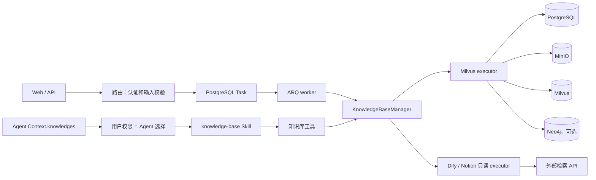
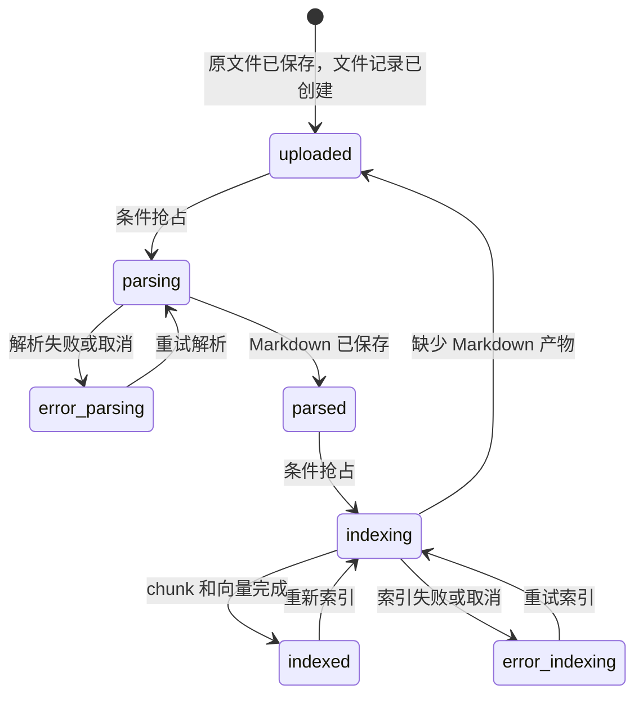

# 知识库机制

本页说明文档怎样从上传走到可检索状态，以及 PostgreSQL、MinIO、Milvus、Neo4j、Durable Task 和 Agent 工具各自负责什么。第一次操作知识库请看[创建并使用知识库](../intro/knowledge-base.md)，解析器配置见[文档处理与 OCR](../advanced/document-processing.md)。

## 能力边界

Yuxi 通过 `KnowledgeBaseManager` 读取知识库配置、解析权限并选择 executor：

- `milvus` 是文档型知识库，支持上传、解析、分块、向量索引、预览和检索，也可以构建知识图谱；
- `dify` 和 `notion` 是只读连接器，只保存外部连接信息并执行 Query，不承载 Yuxi 的上传、解析、索引、文件树和全文预览。

前端按钮只反映 executor 的能力，最终判断由后端完成。只读连接器收到不支持的操作时会明确报错。

## 两条链路

管理链路改变知识库事实，Agent 链路消费当前用户和当前 Agent 可见的知识库：



路由只接收请求并提交任务；Manager 负责配置和 executor 选择；具体 executor 负责解析、索引和检索。知识库配置的最终值在 PostgreSQL，Redis 只缓存最小运行配置，未命中或异常时回源数据库。

## 文档状态机

上传、解析和索引是三个可以分别观察的动作：



历史 `failed`、`done` 状态只作为兼容输入。`parsing` 和 `indexing` 表示当前动作已经抢到执行权；没有抢到允许状态的并发请求会失败，同一文件不会由两个动作同时推进。

- `uploaded`：原文件和文件记录存在，尚未完成解析；
- `parsed`：解析后的 Markdown 路径已写入文件记录；
- `indexed`：本次分块、向量写入和统计更新已完成；
- `error_parsing`、`error_indexing`：对应阶段失败或取消，并保存错误信息。

任务接口的响应和 Durable Task 状态只表示编排结果。验收时重新读取文件状态，并按需核对 Markdown、chunk、向量和图谱数据。

## 各存储负责什么

| 存储 | 拥有的事实 | 不拥有的事实 |
| --- | --- | --- |
| PostgreSQL | 知识库配置、权限、文件元数据和状态、chunk 正文、图谱处理状态、Task 执行意图与 lease | 原文件字节、向量索引 |
| MinIO | 上传原件、解析 Markdown、解析图片 | 文件当前状态、用户权限 |
| Milvus | chunk 向量、BM25/混合检索字段、图实体和关系向量 | 权限、文件状态 |
| Neo4j | 可选的实体、关系和 chunk 关联 | 原文件、权限和检索排序 |
| Redis / ARQ | Task 投递与 worker 唤醒、知识库最小运行配置缓存 | Task 最终状态、配置最终值、文件状态 |

Milvus 索引会把 chunk 写入 PostgreSQL 和 Milvus。它不是跨存储事务：任一侧失败时会尝试补偿并把文件置为 `error_indexing`，排查时需要同时查看两侧。

chunk 的 `source_metadata` 随正文保存在 PostgreSQL，记录解析正文指纹、切分版本、章节和显式原文范围。论文策略直接生成多个来源范围，检索正文保留相关公式定义和图表说明；实验语义关联由独立结构化任务拥有。精确匹配的通用策略块也可以拥有来源。旧块字段为空，重新索引后生成。PDF 页码仅来自同次解析、唯一逐字对应的版面块。

查询命中后按知识库、文件、chunk 标识、顺序和正文核对 PostgreSQL 当前事实，再回填来源。已删除或与 PG 正文不一致的向量命中不返回，避免旧索引文字获得新来源。内容响应另带当前 Markdown 指纹，预览只对版本一致的来源开放定位；无可靠来源时完整正文仍可查看。

## Durable Task 和恢复

上传原文件是同步对象存储操作；批量添加、解析、索引和图谱构建把 `task_type`、Handler 版本和可序列化 payload 保存到 PostgreSQL。提交后 API 只发布 `task_id`，ARQ worker 从 registry 加载领域 Handler。

worker 用唯一 attempt token claim Task 并续租 lease；重复投递和失权 worker 的迟到写入会被 PostgreSQL 拒绝。首次发布失败时，pending Task 保留，启动和周期 publisher 会补发。所有 Durable Task 在 owner 中断或 lease 过期后都会明确失败，不自动重放未知外部副作用。

批量“待解析”和“待入库”入口按状态筛选文件，并通过数据库 dedupe key 拒绝活跃重复任务。取消运行中任务时先保存 `cancel_requested`，由 worker 在控制点收敛。重试前保留故障现场，检查文件记录、MinIO、chunk、Milvus 和 Neo4j，再选择重新解析、重新索引或图谱修复。

## 解析产物与校对

文档主结果和独立附属结果归属于同一次 attempt。主 Markdown 用于预览、下载和后续分块；附属 JSON 保存版面块、图片解释、原生候选、局部修订、未决项和诊断。两者先保存在不可变对象目录，通过知识文件的 markdown_file 和 parse_assets_file 一起发布；未发布的 attempt 只清理自身前缀。旧文件缺少附属指针时，接口返回明确的 legacy 状态，不从旧 Markdown 猜测模型解释。

OXR 适配器拥有表单协议、提交编号和有界查询。知识文件的 parse_runtime 只保存单文件恢复点，处理参数快照不承担运行时状态。已知远端提交编号使用短事务保存，即使收到取消也保留已经发生的远端副作用；恢复点写入仍需有效 Task lease 和文件 owner。正文发布继续检查取消标志和 owner，失权执行不能覆盖当前正文。具体配置与模型选择见[文档处理与 OCR](../advanced/document-processing.md)。

文件级 PostgreSQL advisory lock 串行化解析抢占、发布清理、索引和删除；OXR 等待、原生提取和 PDF 模型调用在文件锁外进行。图谱构建、重置、向量协调和整库删除使用独占维护边界，拒绝仍有处理中 PDF 的知识库；文件变更共享该边界，维护期间等待。已启动的对象写入或外部索引写删在取消时完成清理边界后才释放操作锁，防止旧执行线程在新版本发布后继续写入。

重新解析在新产物准备成功后，清理旧分块、向量、统计和图谱，再原子更新两个产物指针并进入 parsed。外部清理失败时保留旧正文指针供排查；图谱引用删除在外部清理成功后提交，以保留可重试的待删归属。正常入库动作仍对当前正文分块，不隐式触发正文重新识别。文档删除清理该文件全部 attempt 的正文、附属 JSON、图片和预览，存储清理失败保留元数据供重试。

正文和附属 JSON 使用相同知识库 read 权限；文件 ID 必须属于该知识库。前端仅在内容接口与附属接口的 attempt_id 一致时共同展示，版本变化会重读，避免相邻请求串用。下载读取当前正文并通过知识库图片鉴权接口内嵌原图；正文或必要图片读取失败时显式停止导出。

OXR 正文首先执行有精确区域证据的规则，未决才进入完整问题队列的局部模型复核。原始 OCR 与原生证据摘要、规则版本、修复来源和实际用量统计保留在附属产物，正文从修复后的 blocks 重新渲染。原生文字不能单独证明数值/单位等关键内容正确。

正文遗漏检查使用区域类型和版面证据区分出版元素。明确的页眉页脚、页边版权行、相邻页同位置递进页码，以及有同位置重复或版权邻接证据的独立页边 DOI 记为出版元素，保留原生候选与区域证据，并排除待核对计数。正文数字、参考文献 DOI、作者联系信息和 SI 保持原有核对语义；缺少版面佐证的独立数字或 DOI 继续保留。已保存的校对记录需重新解析后重建，刷新页面只读取现有记录。分类取舍与验证见 [PDF 出版区域与正文遗漏分离](../develop-guides/decisions/implemented/2026-11-04-pdf-publication-regions.md)。

普通词可在含公式的段落中独立核对，规则只应用具有唯一邻词对齐和局部逐字几何证据的拼写修正。模型目标扩展为完整词或数学原子；同一位置的一致建议合并应用，互斥建议保留失败记录。完整块重建后检查新增数学损坏、脚本作用范围、词间分隔和意外强调。等价排印保留原字符串；脚本降级及原文标点改变需要独立原生依据，无法证明时保留原文待核。出版元数据、标题层级、浮图续接和参考条目边界由结构规则处理，不能用逐字回执代替。

知识库持久解析在发布正文的同一 Task lease 事务内创建 `knowledge_figure_analysis` intent，事务提交后投递，publisher 可补发。图片 Handler 使用自己的 Task lease，独立于文件已结束的 parsing 状态；只从该文件/attempt 的鉴权原图读取。结果写成同一 attempt 目录内的新附属 revision，经文件锁及正文指针/旧附属指针 CAS 发布，不修改 Markdown、块、校对和索引。提交确认不确定时重读实际指针，无法确认则保留对象，防止删除已发布结果。失败或取消通过任务状态只读投影到图片页签，不把正文变成解析失败。

PDF模型执行模块对同端点/模型使用Redis原子计数和持有者续租，文档内部并发与跨worker额度共同生效。配置拥有者为PostgreSQL；短暂的共享配置行锁覆盖准入而不覆盖模型等待，避免缓存失效失败时继续放行旧额度。PDF调用不设置单次或篇级时限，现有worker/任务取消机制仍控制执行。

回执必须逐问题明确，技术失败不计已核对。目标、快照、原文及证据全部校验通过后，无实际修改的回执按unchanged解释；可靠登记候选仍冲突时进入针对局部字形的复核，仍未消除则保留未决。部分修改通过但其他目标仍冲突时，保留已验证的修改、记录剩余目标并显示待核；不将部分结果写成完整核验缓存。裁图沿真实原生行补邻近文字并避开邻栏、图表，附属证据保存实际裁图区域。重试携带逐问题拒绝代码，校对记录分别保存每次模型建议、实际应用标记和最终拒绝原因。缓存使用当前提示与契约版本，读取后仍执行完整校验。

主解析产物与 `review_status` 分开：`needs_review` 与 `incomplete` 都阻止自动入库，Task 结果分别记录待人工核对与复核未完成的数量；已发布正文不因此判为主解析失败，OCR 或发布失败继续按失败处理。暂不自动入库的提示仅在本次启用自动入库时显示。人工显式入库维持既有操作语义。模型调用先保留服务 usage 再验证正文，已知 token 与未知用量的请求分别汇总，本地缓存不重复计量。详见[文档处理与 OCR](../advanced/document-processing.md)。

知识库管理者可在校对页编辑完整段落，采用 PDF 提取文字后再人工检查，或保留正文并确认。整段确认同时解决该段的相关问题；疑似遗漏需要用户明确选择补入位置，补入的段落保存身份以便再次编辑。人工回执保留原机器记录，已经人工确认的项目不再计入待核对或复核未完成。

人工保存由 `knowledge_review_service` 在同文件操作锁内读取当前 MD 与附属产物，校验 attempt、人工修订版本和正文指纹。正文与结构不一致时要求重新解析，不猜测替换位置。新 MD 与回执写成同 attempt 下的不可变对象，repository 在同一 PostgreSQL 事务比较当前指针和文件状态后一起发布。正文变化时先清理旧分块、向量及图谱，文件回到待入库；确认操作不自动发起入库。清理或发布失败保留旧正文指针，索引清理已发生时可重新入库恢复。后台图片任务在同 attempt 发布时合并最新附属快照，只更新图片字段，保留人工正文与回执。

## 实验卡片机器草稿

`paper` 策略的原文分块和向量入库成功时，[结构化用例](../../backend/package/yuxi/services/knowledge_structure_service.py)在同一 PostgreSQL 事务发布文件 `indexed` 状态和 `knowledge_structure` Task 意图，提交后投递；pending publisher 负责补发。自动入库和单独入库共用这个接续点。其他策略不自动调用实验抽取模型。原文索引与卡片生成是两个阶段，文件 `indexed` 只表示原文可检索。

[抽取模块](../../backend/package/yuxi/knowledge/structure.py)从冻结版本的 Markdown 按段落和完整表格分批生成实验记录。模型直接返回带原文引用的制备步骤或测量，程序校验同一原文块中的样品和字段，回填原文及 Unicode 字符范围，再按样品名称合并卡片。明确标记的方法或结果章节存在时，抽取范围排除引言、参考文献和出版附属栏目。超出输入上限时明确失败。设计取舍及验收见[完整实验记录提案](../develop-guides/decisions/proposed/2026-11-09-experiment-record-first-extraction.md)。

正文的数值编号覆盖可识别的完整单位，包括字面的单位指数和复合单位。模型引用可唯一定位的数值前缀时，按原文回填完整取值。单位边界无法确认的短前缀不入卡。设计和人工验收见[原文取值与出处面板提案](../develop-guides/decisions/proposed/2026-11-09-experiment-source-reading-and-unit-spans.md)。

结构化批次复用[文档模型请求并发配置](../advanced/document-processing.md#完整复核与模型并发)。Worker 按配置并发请求，按原文批次顺序核验证据和归并卡片。调用日志分别记录等待共享额度的 `queue_ms` 和实际调用的 `duration_ms`。

简单矩形 Markdown 和 HTML 表格使用[单元格坐标](../../backend/package/yuxi/knowledge/structure_tables.py)。表格测量的结果须处在样品标签与指标表头的交点，表格条件须来自同一次测量所在的样品行或列。字段出处保留完整表格和原文单元格。无法校验归属的取值及表格制备事实可在未归属区查看。重新 Paper 入库可将旧抽取版本的草稿更新为当前版本。人工案例见[表格单元格证据提案](../develop-guides/decisions/proposed/2026-11-09-experiment-table-cell-evidence.md)。

知识库须显式配置本地聊天模型。单条记录失败时其他通过校验的记录仍可入卡，已找到出处的条件和结果留在候选区。批次响应在正文上限内按条校验，模型报告省略记录或连续两次响应校验失败时标记该批未完成。模型缺失、请求失败、抽取异常且无可核对事实时，Task 与对应 revision 明确记录失败，原文索引保留。Worker 的 `experiment_cards_model` 日志逐次记录阶段、模型、耗时、估算输入 token 与供应商实际 token 用量。批次记录日志包含原文行范围、模型返回条数、成型记录数和拒绝原因分类。验收见[实验批次响应容量提案](../develop-guides/decisions/proposed/2026-11-09-experiment-batch-output-limits.md)。

机器草稿保存在独立 revision、evidence 与 card 表，成功和失败状态随 Task 终态同事务发布。Task 执行和保存前核对当前操作者权限、文档归属、正文版本与 lease；正文更新后，旧草稿在读取时显示失效。

文件详情中的“实验卡片”视图展示独立任务进度、卡片数、已组装记录数及待确认取值。卡片和原文出处分别滚动，选择字段后出处显示对应样品和字段。read 权限可查看，manage 权限可重试当前失败或取消版本。正常生成无需额外点击。机器草稿尚未经过人工确认，不参与正式问答、条件过滤或跨论文比较；扫描完全部输入不代表事实提取完整，零卡片也不表示没有实验。当前人工验收和负向案例见[实验草稿证据编号提案](../develop-guides/decisions/proposed/2026-11-09-experiment-card-evidence-references.md)。

管理者手动入库时，实验任务可使用尚有校对待办的已发布正文。上传后自动入库仍由解析结果的校对状态决定是否继续。

knowledge schema 4→5 只由 `storage-migrator` 创建三个结构化表。已有文件不会批量补抽，使用 Paper 重新入库后自动生成；正文未变化且同模型已有进行中任务或完整草稿时复用，不重复调用模型。部署电脑仍需回读 PostgreSQL、Task、对应 Markdown 和页面，验证真实模型、权限、取消、失联与并发语义。

## Agent 如何看到知识库

运行时准备阶段先按用户权限读取知识库，再与 Agent 的 `Context.knowledges` 求交集，结果保存为 `_visible_knowledge_bases`。工具的 `kb_id`、`file_id` 和文件名必须属于这份运行时快照；新的 Run 会重新计算权限，正在运行的 Context 不会因中途撤权而自动刷新。

知识库工具由内置 `knowledge-base` Skill 提供。模型读取该 Skill 的 `SKILL.md` 后，才会看到：

```text
list_kbs、query_kb、find_kb_document、open_kb_document、
get_mindmap、search_file、download_kb_file
```

推荐顺序是：列出可见知识库 → 检索候选片段 → 用 `file_id` 打开或定位原文。`download_kb_file` 会把有权访问的原始二进制写入当前 Project 的 `outputs`，供后续工具处理。知识库不会映射为 `/home/gem/kbs` 沙盒目录。

## 权限

知识库的最终授权由后端依赖、Manager 可见性查询和具体工具目标校验共同完成：

- 读取、检索、打开和下载需要 read 权限；
- 创建、更新、添加文件、解析、索引、删除和图谱写操作需要 manage 权限；
- 原文件上传入口要求管理员，并在传入 `kb_id` 时继续检查该知识库的 manage 权限；
- 前端守卫、按钮隐藏、Agent 配置和提示词只控制呈现或缩小范围，不能授予权限。

Agent 的 `knowledges` 只能缩小用户已有权限。子智能体使用自己的配置，但仍沿用发起用户的身份。私有解析图片通过带知识库权限校验的 API 读取，MinIO 对象 URL 不是授权凭证。

## 失败和重试

- 解析失败或取消：文件进入 `error_parsing`，查看错误并重新提交解析；批量待解析入口只扫描 `uploaded`。
- 索引失败或取消：文件进入 `error_indexing`，检查分块、嵌入和存储后重新入库；批量待入库入口扫描 `parsed` 和 `error_indexing`。
- 索引缺少 Markdown：文件回到 `uploaded`，必须重新解析，不会生成空索引。
- Durable Task 失败、取消或 lease 过期：只能说明后台动作未完成，不能推断外部存储没有部分写入；知识任务不会在未知副作用上自动重放。
- Redis 缓存异常：Manager 回源 PostgreSQL；不支持的知识库类型或 executor 初始化失败会明确阻止操作。

## 源码定位与验证

- [知识库路由](https://github.com/xerrors/Yuxi/blob/main/backend/server/routers/knowledge_router.py)：权限、上传、任务和状态筛选
- [KnowledgeBaseManager](https://github.com/xerrors/Yuxi/blob/main/backend/package/yuxi/knowledge/manager.py)：配置回源、可见性和 executor 调度
- [知识库基类](https://github.com/xerrors/Yuxi/blob/main/backend/package/yuxi/knowledge/base.py)：文件状态和解析流程
- [Milvus executor](https://github.com/xerrors/Yuxi/blob/main/backend/package/yuxi/knowledge/implementations/milvus.py)：分块、双写、检索和重索引
- [只读连接器](https://github.com/xerrors/Yuxi/blob/main/backend/package/yuxi/knowledge/implementations/read_only_connectors.py)：Dify/Notion 能力边界
- [Durable Task runtime](https://github.com/xerrors/Yuxi/blob/main/backend/package/yuxi/services/task_service.py)：任务持久化、claim、lease 和恢复结局
- [Task Handler registry](https://github.com/xerrors/Yuxi/blob/main/backend/package/yuxi/services/task_registry.py)：领域 Handler 注册和惰性加载
- [知识库工具](https://github.com/xerrors/Yuxi/blob/main/backend/package/yuxi/agents/toolkits/kbs/tools.py)：Agent 目标校验和工具实现

修改状态、权限、存储或 Agent 工具链路时，由用户在部署电脑通过真实 HTTP 人工操作完整流程，并从 PostgreSQL、MinIO、Milvus 或 Neo4j 回读最终结果。
